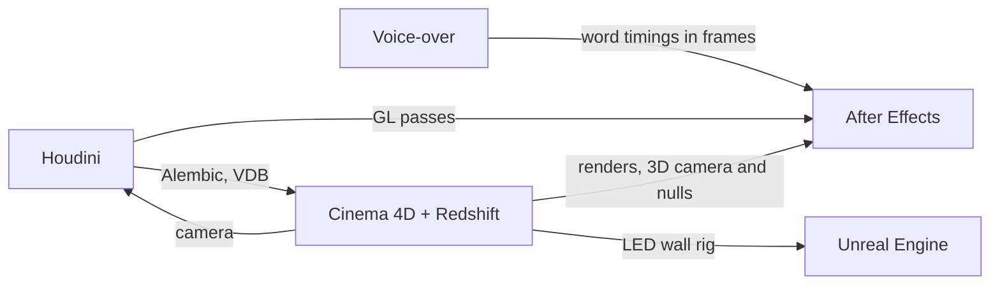

# Claude skills for 3D and motion design

**Production-tested know-how that lets Claude work in Houdini, Cinema 4D, Unreal Engine, After
Effects and Premiere Pro.**

Through MCP, Claude can already call an app's Python API. What it lacks is the knowledge you only
get by doing the work: which parameter ID does the job, which call crashes the editor, which setup
looked right and did nothing. These 27 [Agent Skills](https://docs.claude.com/en/docs/agents-and-tools/agent-skills/overview)
hold that knowledge. Each one was written during real production work and grows with every session.

- **Verified or labelled.** A recipe goes in only after it worked in a real scene, with the version
  and OS it was tested on. Anything else is marked *(unverified)*.
- **Dead ends included.** Approaches that failed are written down with the reason, so Claude doesn't
  try them again.
- **No project data.** Client names, paths and shot details stay in private project notes
  ([project-notes](project-notes/SKILL.md)). The skills keep only what carries over to the next job.

### What you can ask

- *"Turn these POP particles into liquid blobs and bring them into Cinema 4D with their colours."*
- *"Make a take for each colour variant and render them all through the Render Queue."*
- *"The camera solve stops at frame 183. Extend it to the end of the shot."*
- *"Put the camera on a rail and render one Movie Render Queue job per LED wall."*
- *"Retime these After Effects keys to the voice-over."*
- *"Relink this Premiere project to the transcoded MP4s and prove nothing changed in the cut."*

### Hand-offs between apps

The skills also cover the hand-offs between apps:



## The skills

Each app has a **core** skill that Claude loads every time it touches that app. The core skill
tells Claude which of the others to load for the task. Folder names start with the app, so the
repo lists them in the same groups.

### Houdini

Connects through [capoomgit/houdini-mcp](https://github.com/capoomgit/houdini-mcp) and headless `hython`.

| Skill | What it's for |
|---|---|
| [houdini-mcp](houdini-mcp/SKILL.md) | **Core: start here.** Installing the bridge on Windows and macOS, call timeouts, parking the display flag so sims don't cook on every call, `hou` API traps, keys from Python, caching long sims in the background, moving a project to another machine, FBX and Alembic import. |
| [houdini-pop-particles](houdini-pop-particles/SKILL.md) | **Particle sims that behave.** Collisions that really contain and bounce particles (and the setups that failed), sources and bursts, physics-based spray slow-down, following a moving piston, clumping, speed ramps, how to measure a sim. |
| [houdini-pyro-smoke](houdini-pyro-smoke/SKILL.md) | **Smoke and fire in a closed, moving container.** CAD colliders with velocity, a chamber that expands and then exhausts through a valve, sources that follow a moving volume, a flame envelope around an object, dissipation in real units, caching. |
| [houdini-vdb-surfacing](houdini-vdb-surfacing/SKILL.md) | **Particles into liquid-like blobs.** VDB from particles, smoothed SDF, mesh with the colour transferred back, settings that work, blob-count checks, rescaling when the particle count changes. |
| [houdini-flipbook](houdini-flipbook/SKILL.md) | **Previews and comp passes.** Viewport flipbooks to image sequences, OpenGL ROP passes with real alpha from `hython`, a camera copied from Cinema 4D, volume display for smoke and fire passes. |
| [houdini-network-layout](houdini-network-layout/SKILL.md) | **Networks other people can read.** Numbered network boxes, sticky notes, node comments, grid layout with overlap checks, and a safe way to delete "unused" nodes. |
| [houdini-to-cinema4d](houdini-to-cinema4d/SKILL.md) | **Sims out to Cinema 4D and Redshift.** The Alembic export chain that works (attribute clean-up, scale, `width` instead of `pscale`), particles for RS Particle Groups, VDBs for RS Volume, meshes with point attributes for vertex maps, one-frame test exports, re-exports without re-simulating. |

### Cinema 4D

Connects through Maxon's built-in MCP server (C4D 2026.4 and later) or the community
[ttiimmaacc/cinema4d-mcp](https://github.com/ttiimmaacc/cinema4d-mcp) plugin, plus headless `c4dpy`.
Step-by-step setup: [cinema4d-mcp/SETUP.md](cinema4d-mcp/SETUP.md).

| Skill | What it's for |
|---|---|
| [cinema4d-mcp](cinema4d-mcp/SKILL.md) | **Core: start here.** Telling the two servers apart and setting them up, `exec_python` rules, headless `c4dpy` for long jobs, what changes after a C4D upgrade, Render Queue traps, keys from Python, testing in throwaway documents. Scripts for a scene inventory, camera visibility and clean asset extraction. |
| [cinema4d-redshift](cinema4d-redshift/SKILL.md) | **Redshift materials and renders.** Node materials through the maxon graph API with node and port IDs, look recipes (emission-only gold, atmosphere rim, gradient sky, liquids and glass), RS volumes, fast render settings, image sequences on textures, rendering a take from a script, and dead ends. |
| [cinema4d-particles](cinema4d-particles/SKILL.md) | **Native particles (2024 and later).** Object IDs, emitters and groups, Data Mapper, Math, Condition and Reproduce, per-group drag, measured forces, Cloner on particles, Redshift, plus recipes for a travelling trail and delayed 360° bursts. |
| [cinema4d-alembic](cinema4d-alembic/SKILL.md) | **Alembic in.** Importer options from Python, frame mapping, checking an import against the scene, particle channels, mesh point attributes as animated vertex maps driving MoGraph (tested with 500k clones), coloured sim previews in the Viewport Renderer. |
| [cinema4d-rigging](cinema4d-rigging/SKILL.md) | **Control rigs.** User data and keyed controls, Python tag drivers, dropdowns that follow a folder, even-speed travel along a spline, a live slider-crank piston, Python generators, the one-frame lag between tags, retiming cycle controls, HUD. |
| [cinema4d-takes](cinema4d-takes/SKILL.md) | **Variants as takes.** Reading and adding overrides (user data included), override groups, per-take cameras and render settings, splitting an edit camera into shot takes, promoting a take to Main, rendering many takes through the Render Queue, splitting a shot into passes. |
| [cinema4d-render-preview](cinema4d-render-preview/SKILL.md) | **Letting Claude see the render.** Small renders returned as base64 JPEG, crops and contact sheets, isolating one effect, cheap numeric checks, comparing against reference footage, viewport screenshots. |
| [cinema4d-motion-tracker](cinema4d-motion-tracker/SKILL.md) | **Camera tracking from Python.** Reading tracks and the 3D solve, why a solve stops, tracking new and AI-generated footage, extending a solve past an occlusion (PnP, triangulation, bundle adjustment), de-jittering, object tracks, real-world scale, baking a clean camera. Includes six scripts. |

### Unreal Engine

Connects through Epic's built-in Unreal MCP plugin (UE 5.8, experimental) and Python remote
execution. No third-party server.

| Skill | What it's for |
|---|---|
| [unreal-mcp](unreal-mcp/SKILL.md) | **Core: start here.** Enabling and auto-starting the MCP plugin, using its toolsets, Python remote execution with [ue_exec.py](unreal-mcp/scripts/ue_exec.py), viewport captures Claude can look at, calls that crash the editor, where the logs are. |
| [unreal-materials-python](unreal-materials-python/SKILL.md) | **Materials from code.** Materials, material functions and parameter collections from Python, Custom HLSL nodes, injecting a function into existing materials (Substrate too) and finding every master a level uses, keeping emissive out of Lumen GI, post-process overlays, data textures, compile errors. |
| [unreal-sequencer-python](unreal-sequencer-python/SKILL.md) | **Sequences and renders.** Level Sequences with a keyed cine camera or a camera on a movable rail, camera cuts, animated parameter collections, auto-play on Play, Movie Render Queue jobs and presets, checking the result in Play-In-Editor. |
| [unreal-led-volume-rig](unreal-led-volume-rig/SKILL.md) | **Multi-screen LED rooms and CAVEs.** Reading an existing Cinema 4D rig headless, converting film offsets to sensor offsets, screens that meet edge to edge, keeping the rig level on a rail, one sequence and render preset per screen. |
| [unreal-editor-tools](unreal-editor-tools/SKILL.md) | **Buttons for the artist.** A custom menu registered at every editor start, undoable actions, progress and message dialogs, piloting actors, reading and setting the viewport camera, Game View. |
| [unreal-content-management](unreal-content-management/SKILL.md) | **Reorganising content without breaking it.** Batch moves and redirectors, tidying the Outliner, moving maps (and the crash to avoid), World Partition and one-file-per-actor levels, what adding a sample does to config, backups, folder colours. |
| [unreal-ultra-dynamic-sky](unreal-ultra-dynamic-sky/SKILL.md) | **Ultra Dynamic Sky.** Replacing a template sky with it, reading and setting its ~1000 Blueprint variables through MCP, locking exposure for renders. |

### After Effects and Premiere Pro

There is no MCP server for either app. Each bridge is a small CEP panel included here: Claude drops
a script into an inbox folder and the panel writes the result back as JSON.

| Skill | What it's for |
|---|---|
| [aftereffects-bridge](aftereffects-bridge/SKILL.md) | **After Effects, Windows and macOS.** A [panel](aftereffects-bridge/panel) that runs only signed scripts, installers for both systems, inspecting comps, preview frames, render-queue exports, swapping renders in an OCIO project, Cinema 4D camera and nulls matched to 0.04 px, retiming keys to a voice-over, HUD and UI layers. |
| [aftereffects-scripting](aftereffects-scripting/SKILL.md) | **After Effects from a macOS shell, no panel.** AppleScript plus ExtendScript for reading comps and markers, shot tables, review comps, one layer per shot, compositing passes from other apps, time-remap holds, split screens, render-queue frame checks. |
| [premiere-bridge](premiere-bridge/SKILL.md) | **Premiere Pro, Windows.** A self-signed [panel](premiere-bridge/panel) (CEP 12 ignores debug mode), inspecting sequences and bins, frame export, relinking to transcoded media with before-and-after proof, transcode settings that keep the picture identical. |

### Any app

| Skill | What it's for |
|---|---|
| [vo-timing](vo-timing/SKILL.md) | **Animation keyed to the voice-over.** Word-level timings from an mp3 or wav with faster-whisper, converted to frames at the project frame rate. |
| [project-notes](project-notes/SKILL.md) | **Memory between sessions.** One private `NOTES.md` per production (brief, beats, VO timings, file map, verified state, open tasks), read at the start of a task and updated at the end. |

## Requirements

| App | How Claude connects | Tested on |
|---|---|---|
| Houdini | [capoomgit/houdini-mcp](https://github.com/capoomgit/houdini-mcp) | Houdini 21–22 Indie, Windows and macOS |
| Cinema 4D | Maxon's built-in MCP server (2026.4+) or [ttiimmaacc/cinema4d-mcp](https://github.com/ttiimmaacc/cinema4d-mcp) | Cinema 4D 2026–2027 with Redshift, Windows and macOS |
| Unreal Engine | Epic's Unreal MCP plugin + Python remote execution | UE 5.8, Windows |
| After Effects | Included panel, [install.ps1](aftereffects-bridge/scripts/install.ps1) or [install.sh](aftereffects-bridge/scripts/install.sh) | AE 2026, Windows and macOS |
| Premiere Pro | Included panel, [install.ps1](premiere-bridge/scripts/install.ps1) | Premiere 2026, Windows |

Setup notes, including the problems we ran into, are in each app's core or bridge skill.

## Installation

**Claude Code, by app.** Add this repo as a plugin marketplace and install the apps you use:

```bash
claude plugin marketplace add dima-rdnv/claude-skills
```

```bash
claude plugin install cinema4d@dima-rdnv
```

The plugins are `houdini`, `cinema4d`, `unreal`, `adobe` and `production`. To get new findings
later, run `claude plugin marketplace update dima-rdnv` and then `claude plugin update
cinema4d@dima-rdnv`. Skills installed this way are named with the plugin first, for example
`cinema4d:cinema4d-redshift`.

**Claude Code, as a git clone.** Use this if you want Claude to add its own findings back into the
skills. If you don't have a `~/.claude/skills` folder yet, clone straight into it:

```bash
git clone https://github.com/dima-rdnv/claude-skills.git ~/.claude/skills
```

If the folder already exists, clone elsewhere and copy the skill folders in:

```bash
git clone https://github.com/dima-rdnv/claude-skills.git
for d in claude-skills/*/; do cp -R "${d%/}" ~/.claude/skills/; done
```

**Claude apps (claude.ai, Desktop).** Zip a skill folder (the folder itself, with `SKILL.md`
inside) and upload it in Claude's Skills settings.

## How the skills stay current

Each skill ends with a short *Keeping this skill current* section. After a session, Claude writes
down what it learned: verified facts only, fixes to entries that turned out wrong, and each finding
in the skill it belongs to. Anything about one production goes into that production's notes, never
into a skill.

## Contributing

Issues and pull requests are welcome, especially recipes verified on other versions or platforms.
Follow the same rule: say what you tested it on, and mark anything untested *(unverified)*.

## License

[MIT](LICENSE)
